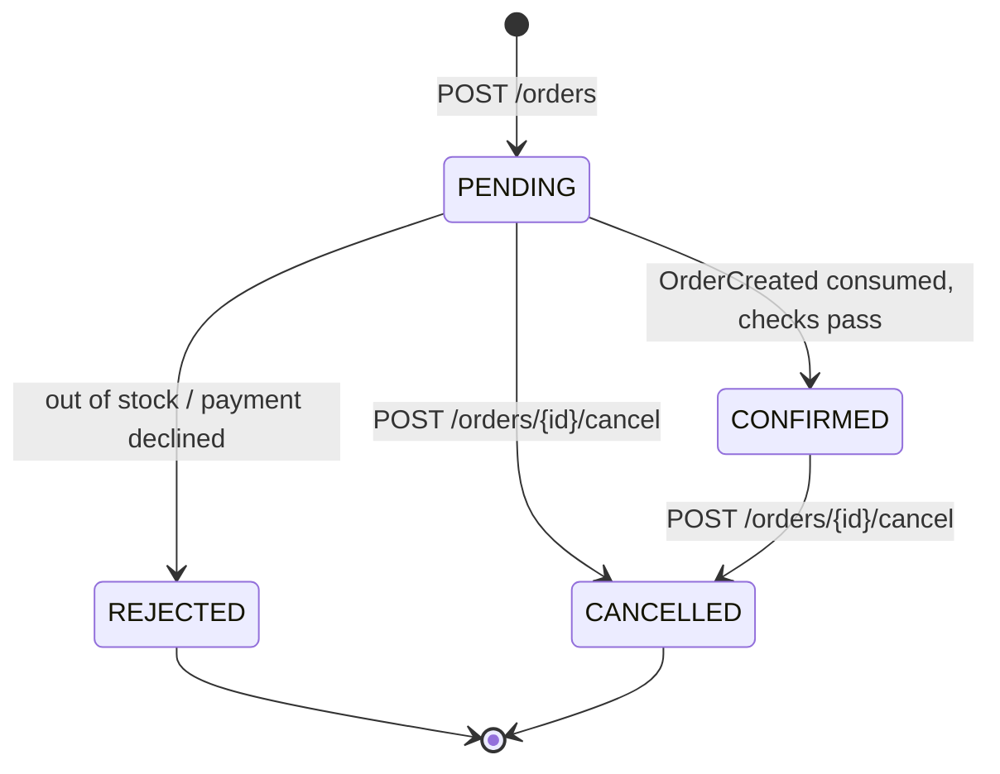
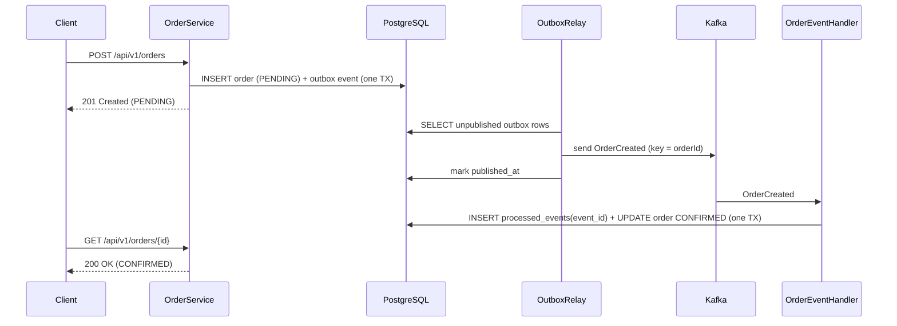

# OrderFlow Service

[](https://github.com/Mohangab/orderflow-service/actions/workflows/ci.yml)


An **event-driven order processing microservice** built with Spring Boot 3, Apache Kafka and PostgreSQL.

Orders are accepted over REST and stored as `PENDING`. An `OrderCreated` event is written to a
**transactional outbox** in the same database transaction, relayed to Kafka, and picked up by an
**idempotent consumer** that simulates inventory and payment checks and moves the order to
`CONFIRMED` or `REJECTED`. Customers can cancel orders, which emits an `OrderCancelled` event.

The point of the project is to show the patterns that keep a service like this correct when the
broker is down, messages are redelivered, or two things happen to the same order at once.

## Highlights

- **Transactional outbox**: order rows and their events commit atomically, so no "saved but never published" (or the reverse).
- **At-least-once delivery + idempotent consumer**: every handled event id is stored in `processed_events`. Redeliveries are detected and skipped.
- **Per-order ordering**: the order id is the Kafka record key, so all events for one order go to the same partition.
- **Retries + dead-letter topic**: failed records are retried 3 times, then parked on `orders.events.DLT`. Malformed JSON skips the retries.
- **Explicit state machine** on the `Order` aggregate (`PENDING → CONFIRMED / REJECTED`, `PENDING|CONFIRMED → CANCELLED`) with optimistic locking (`@Version`).
- REST API with Bean Validation, DTOs, pagination and filtering, plus RFC 7807 `problem+json` errors from a global exception handler.
- Flyway migrations, OpenAPI / Swagger UI, Actuator health.
- 35 tests: JUnit 5 + Mockito unit tests, `@WebMvcTest` slice tests, and an end-to-end integration test on **embedded Kafka (KRaft)**.
- Multi-stage, layered Docker image running as a non-root user. Docker Compose stack with PostgreSQL, Kafka (KRaft, no ZooKeeper) and Kafka UI.
- GitHub Actions CI runs `mvn verify` and builds the Docker image.

## Architecture

```mermaid
flowchart LR
    client([Client]) -->|POST /api/v1/orders| api[OrderController]
    api --> svc[OrderService]

    subgraph tx [Single DB transaction]
        svc -->|insert| orders[(orders + order_items)]
        svc -->|insert| outbox[(outbox_events)]
    end

    relay[OutboxRelay<br/>@Scheduled] -->|poll unpublished| outbox
    relay -->|key = orderId| topic{{Kafka: orders.events}}

    topic --> consumer[OrderEventConsumer]
    consumer --> handler[OrderEventHandler<br/>idempotent]
    handler -->|seen?| processed[(processed_events)]
    handler --> sim[InventoryPaymentSimulator]
    handler -->|CONFIRMED / REJECTED| orders
    consumer -. after 3 retries .-> dlt{{orders.events.DLT}}
```

### Order lifecycle



### Sequence of a successful order



### Processing rules (simulated downstream services)

The rules are configured under `app.processing` in `application.yml`:

| Rule | Default | Result |
|------|---------|--------|
| SKU listed in `out-of-stock-skus` | `SKU-OUT-OF-STOCK` | `REJECTED`: "Inventory: … is out of stock" |
| Quantity per SKU above `max-quantity-per-sku` | `100` | `REJECTED`: "Inventory: insufficient stock …" |
| Order total above `max-order-amount` | `5000.00` | `REJECTED`: "Payment: amount … exceeds limit …" |
| Otherwise | | `CONFIRMED` |

## Tech stack

| Area | Technology |
|------|------------|
| Language / framework | Java 17, Spring Boot 3.3 (Web, Validation, Data JPA, Actuator) |
| Messaging | Apache Kafka (KRaft), Spring for Apache Kafka |
| Database | PostgreSQL 16, Flyway, Hibernate |
| API docs | springdoc-openapi (Swagger UI) |
| Testing | JUnit 5, Mockito, AssertJ, Spring Boot Test, `@EmbeddedKafka`, H2 (PostgreSQL mode), Awaitility |
| Build / ops | Maven wrapper, Docker (multi-stage, layered jar), Docker Compose, GitHub Actions |

## Running it

### Option 1: everything in Docker (recommended)

```bash
git clone https://github.com/Mohangab/orderflow-service.git
cd orderflow-service
docker compose up --build
```

| Service | URL |
|---------|-----|
| API | http://localhost:8080/api/v1/orders |
| Swagger UI | http://localhost:8080/swagger-ui.html |
| OpenAPI JSON | http://localhost:8080/v3/api-docs |
| Health | http://localhost:8080/actuator/health |
| Kafka UI | http://localhost:8081 |
| PostgreSQL | `localhost:5432` (db/user/password: `orderflow`) |
| Kafka (host clients) | `localhost:9092` |

Stop with `docker compose down` (add `-v` to wipe the database volume).

### Option 2: app on the host, infrastructure in Docker

```bash
docker compose up -d postgres kafka kafka-ui
./mvnw spring-boot:run
```

### Configuration

| Env variable | Default |
|--------------|---------|
| `DB_URL` | `jdbc:postgresql://localhost:5432/orderflow` |
| `DB_USERNAME` / `DB_PASSWORD` | `orderflow` / `orderflow` |
| `KAFKA_BOOTSTRAP_SERVERS` | `localhost:9092` |

## API examples

**Create an order** (returns `201` with a `Location` header; status starts as `PENDING`):

```bash
curl -i -X POST http://localhost:8080/api/v1/orders \
  -H 'Content-Type: application/json' \
  -d '{
        "customerId": "customer-42",
        "items": [
          { "sku": "SKU-KEYBOARD-01", "quantity": 1, "unitPrice": 49.99 },
          { "sku": "SKU-MOUSE-02",    "quantity": 2, "unitPrice": 19.50 }
        ]
      }'
```

```json
{
  "id": "6f1c2a9e-4a7b-4f43-9d0f-2f3c1b8a7e11",
  "customerId": "customer-42",
  "status": "PENDING",
  "statusReason": null,
  "totalAmount": 88.99,
  "items": [
    { "sku": "SKU-KEYBOARD-01", "quantity": 1, "unitPrice": 49.99, "lineTotal": 49.99 },
    { "sku": "SKU-MOUSE-02", "quantity": 2, "unitPrice": 19.50, "lineTotal": 39.00 }
  ],
  "createdAt": "2026-10-09T06:30:00.123Z",
  "updatedAt": "2026-10-09T06:30:00.123Z"
}
```

**Fetch it again a moment later**. The consumer has already processed it:

```bash
curl http://localhost:8080/api/v1/orders/6f1c2a9e-4a7b-4f43-9d0f-2f3c1b8a7e11
# ... "status": "CONFIRMED" ...
```

**See a rejection** (out-of-stock SKU):

```bash
curl -s -X POST http://localhost:8080/api/v1/orders \
  -H 'Content-Type: application/json' \
  -d '{"customerId":"customer-42","items":[{"sku":"SKU-OUT-OF-STOCK","quantity":1,"unitPrice":10}]}'
# then GET it: "status": "REJECTED", "statusReason": "Inventory: SKU-OUT-OF-STOCK is out of stock"
```

**List orders** with filters, pagination and sorting:

```bash
curl 'http://localhost:8080/api/v1/orders?customerId=customer-42&status=CONFIRMED&page=0&size=10&sort=createdAt,desc'
```

```json
{ "content": [ { "id": "…", "status": "CONFIRMED", "…": "…" } ], "page": 0, "size": 10, "totalElements": 1, "totalPages": 1 }
```

**Cancel an order** (the body is optional):

```bash
curl -X POST http://localhost:8080/api/v1/orders/6f1c2a9e-4a7b-4f43-9d0f-2f3c1b8a7e11/cancel \
  -H 'Content-Type: application/json' \
  -d '{"reason": "Found a better deal"}'
```

**Errors** use `application/problem+json`:

```bash
curl -s -X POST http://localhost:8080/api/v1/orders -H 'Content-Type: application/json' \
  -d '{"customerId":"","items":[{"sku":"A","quantity":0,"unitPrice":1}]}'
```

```json
{
  "type": "about:blank",
  "title": "Validation failed",
  "status": 400,
  "detail": "Request body has invalid fields",
  "instance": "/api/v1/orders",
  "errors": { "customerId": "must not be blank", "items[0].quantity": "must be greater than or equal to 1" }
}
```

| Endpoint | Description |
|----------|-------------|
| `POST /api/v1/orders` | Create an order (`201`, `400`) |
| `GET /api/v1/orders/{id}` | Get one order (`200`, `404`) |
| `GET /api/v1/orders?customerId=&status=&page=&size=&sort=` | Paginated list (max page size 100) |
| `POST /api/v1/orders/{id}/cancel` | Cancel (`200`, `404`, `409` if already rejected or cancelled) |

**Watch the events** in Kafka UI (http://localhost:8081 → Topics → `orders.events`) or on the CLI:

```bash
docker compose exec kafka /opt/kafka/bin/kafka-console-consumer.sh \
  --bootstrap-server localhost:9092 --topic orders.events --from-beginning --property print.key=true
```

## Event contract

Topic `orders.events`. The record key is the order id. Headers: `eventType`, `eventId`.

```json
{
  "eventId": "0b8a…",
  "eventType": "OrderCreated",
  "orderId": "6f1c…",
  "customerId": "customer-42",
  "totalAmount": 88.99,
  "items": [ { "sku": "SKU-KEYBOARD-01", "quantity": 1 } ],
  "reason": null,
  "occurredAt": "2026-10-09T06:30:00.125Z"
}
```

`eventType` is `OrderCreated` or `OrderCancelled`. The `reason` field is filled in for cancellations.

## Testing

```bash
./mvnw verify
```

Docker is not required. The integration test (`OrderFlowIntegrationTest`) starts an **embedded KRaft
Kafka broker** and an H2 database in PostgreSQL mode. It runs the real Flyway migrations and checks
the whole path from REST through the outbox, Kafka and the consumer to the status update, including:

- a valid order becomes `CONFIRMED`; out-of-stock and over-limit orders become `REJECTED`
- cancelling a confirmed order emits and consumes `OrderCancelled`
- **re-sending the same `OrderCreated` event does not process it twice** (idempotency)
- pagination and filtering, Actuator health and the OpenAPI document

## Project structure

```
src/main/java/com/mohan/orderflow
├── api/             REST controller, DTOs, global exception handler
├── config/          OpenAPI, Kafka topics/error handling, typed @ConfigurationProperties
├── domain/          Order aggregate + state machine, OutboxEvent, ProcessedEvent
├── event/           OrderEvent integration-event contract
├── outbox/          OutboxWriter (same TX) and OutboxRelay (scheduled publisher)
├── processing/      Kafka consumer, idempotent handler, inventory/payment simulator
├── repository/      Spring Data JPA repositories
└── service/         OrderService use cases
src/main/resources/db/migration   Flyway SQL migrations
```

## Design notes and next steps

- **Why an outbox and not `kafkaTemplate.send()` in the service?** Writing to the DB and then to Kafka is a dual write: a crash between the two loses the event or leaves an order that was never saved. The outbox turns it into a single local transaction plus an asynchronous relay.
- **Delivery semantics.** The relay marks a row published only after the broker acks it, so delivery is at-least-once. Exactly-once *processing* comes from the idempotent consumer.
- **Scaling the relay.** With several instances, the relay query should use `SELECT … FOR UPDATE SKIP LOCKED` or a leader lock (e.g. ShedLock). Debezium CDC is another option for tailing the outbox.
- **Next steps:** split the processor into separate inventory and payment services that publish `OrderConfirmed`/`OrderRejected` events (choreographed saga), add JWT security, and add Testcontainers-based tests against real PostgreSQL/Kafka.

## License

[MIT](LICENSE) © 2026 Mohan Venkatesh Kola
